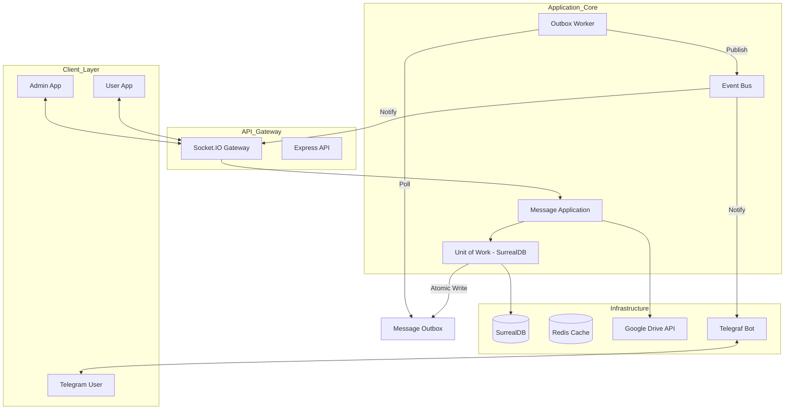

# Chat-Community

Hệ thống chat cộng đồng thời gian thực được xây dựng trên nền tảng **Clean Architecture** và **Event-Driven Design**. Dự án tập trung vào tính tin cậy của dữ liệu (Outbox Pattern) và khả năng tích hợp đa kênh (Websocket, Telegram).

## 🏗️ System Architecture



## 🚀 Tech Stack

- **Runtime**: Node.js + TypeScript
- **Database**: SurrealDB (Multi-model database)
- **Real-time**: Socket.IO
- **Caching**: Redis
- **File Storage**: Google Drive API
- **Framework**: Express.js
- **Bot Engine**: Telegraf (Telegram Bot API)

## ✨ Key Features & Patterns

- **Clean Architecture**: Phân tách rõ ràng giữa Domain, Application và Infrastructure.
- **Transactional Outbox Pattern**: Đảm bảo tin nhắn luôn được gửi đi ngay cả khi hệ thống Socket/Telegram gặp sự cố tạm thời.
- **Unit of Work**: Quản lý transaction nguyên tử trên SurrealDB.
- **Session Management**: Cơ chế "Graceful Disconnect" (F5/Reconnect) tránh spam thông báo online/offline.
- **File Processing**: Upload và quản lý file thông qua Google Drive Service Account.
- **Telegram Integration**: 
    - Tự động notify cho Admin khi có tin nhắn mới mà admin đang offline.
    - Bot hỗ trợ tạo Poll (Badminton, Boardgame) trực tiếp.

## ⚠️ Giới hạn triển khai: chỉ chạy MỘT instance

Redis adapter của Socket.IO giúp phát event qua nhiều process, nhưng các trạng thái sau
vẫn nằm trong RAM của từng process:

- Danh sách user online và bộ đếm kết nối (`SocketRoomJoinRegistry`)
- Timer grace period khi user mất kết nối (`SessionManager`)
- EventBus nội bộ (`InMemoryEventBus`)

Chạy từ 2 instance trở lên thì danh sách online, thông báo online/offline và việc dọn
phiên sẽ sai. Hãy chạy **một instance** (PM2 `instances: 1`, không dùng cluster mode).
Outbox worker đã an toàn khi chạy nhiều instance (claim nguyên tử), nhưng phần trên thì chưa.

## 🔐 Hợp đồng API (tóm tắt)

- Mọi route `/api/message/*` và `POST /api/auth/:userId/end` yêu cầu header
  `Authorization: Bearer <accessToken>`.
- `sender` luôn lấy từ token; `readerId` ở `mark-read`/`unread-count` cũng lấy từ token.
  User chỉ gửi được cho `admin` và chỉ đọc hội thoại của chính mình; admin đọc được tất cả.
- `POST /api/message/insert` (multipart): `receiver`, `content`, file ở field `file` hoặc
  `files` (tối đa `UPLOAD_MAX_FILES_PER_MESSAGE`). Nhiều file = **một** tin có `attachments[]`.
  Client không còn gửi được `imageURL`/`fileURL` tự đặt (tránh lách kiểm duyệt ảnh).
- Socket `message:send`: `{ receiver, content?, files?: [{ data, name, mimeType }] }`.
  Lưu thất bại sau khi đã ack → server gửi `message:error { tempId, reason }`.
- Access token và refresh token mang claim `type`; refresh token không dùng để kết nối socket
  được. Token phát hành trước bản cập nhật này không còn hợp lệ → client đăng nhập lại.
- Đăng nhập admin bị giới hạn `ADMIN_LOGIN_MAX_ATTEMPTS` lần sai / `ADMIN_LOGIN_WINDOW_SECONDS`
  theo IP. Chạy sau nginx thì phải đặt `TRUST_PROXY`, nếu không mọi client chung một IP.

## 🛠️ Installation

1. Copy `.env.example` thành `.env.development`.
2. Cấu hình SurrealDB và Redis.
3. Cấu hình Telegram Bot Token & Google Service Account (nếu dùng upload).
4. Chạy lệnh:
```bash
npm install
npm run dev
```

Kiểm tra trước khi đẩy code (CI cũng chạy đúng các lệnh này):

```bash
npm run type-check && npm run lint && npm test
```

## 📈 Logging & Monitoring

### Luồng

```
App (pino, JSON → stdout) → PM2 (~/.pm2/logs/<app>-out.log) → Alloy (tail file) → Loki → Grafana (dashboard + alert Telegram)
```

App **không gửi log qua mạng**. Nó chỉ ghi stdout, nên Loki, Alloy hay Grafana có chết thì luồng chat vẫn chạy bình thường.
Stack monitoring chiếm khoảng 1GB RAM theo `mem_limit` (Loki 512m, Alloy 256m, Grafana 256m), dùng thực tế thường thấp hơn. Mức này vừa với VPS 4GB.

### Log có cấu trúc

- Mỗi dòng log là một JSON gồm `level`, `time`, `service`, `module`, `msg`, cùng context lấy tự động từ `AsyncLocalStorage`.
- `requestId` được sinh cho mỗi HTTP request (nhận lại header `x-request-id` nếu client gửi hợp lệ, và luôn trả về trong response) và cho mỗi socket event.
  `requestId` được lưu vào bản ghi outbox, nên khi `OutboxWorker` xử lý (kể cả retry) log vẫn mang đúng `requestId` gốc.
  Với một `requestId`, ta lần được toàn bộ luồng: API/socket → DB → outbox → handler → Telegram/socket.
- Mỗi request có đúng một dòng `request completed`: `method`, `path` (không kèm query string), `statusCode`, `durationMs`, `userId`, `errorCode`.
- Các key nhạy cảm (`password`, `token`, `accessToken`, `refreshToken`, `authorization`, `cookie`, …) bị thay bằng `[REDACTED]`.
- Biến môi trường: `LOG_LEVEL` (mặc định `info` ở production, `debug` ở dev) và `LOG_PRETTY=true` để log dễ đọc khi dev.
- Code mới dùng `createLogger("<module>")` trong `src/shared/logging/logger.ts`, không dùng `console.*`. Lỗi truyền qua key `err`.

### Cài trên VPS (một lần)

```bash
pm2 install pm2-logrotate
pm2 set pm2-logrotate:max_size 50M
pm2 set pm2-logrotate:retain 7
pm2 set pm2-logrotate:compress true

cd <thư mục clone repo>
cp .env.example .env
docker compose -f docker-compose.monitoring.yml up -d
```

Trong `.env` cần có: `GRAFANA_ADMIN_PASSWORD`, `TELEGRAM_BOT_TOKEN`, `TELEGRAM_CHAT_ID` (dùng cho alert), `PM2_APP_NAME`, `PM2_LOG_DIR`.
Grafana chỉ bind `127.0.0.1`. Truy cập bằng SSH tunnel:

```bash
ssh -L 3001:localhost:3001 root@<vps>
```

Sau đó mở `http://localhost:3001`, vào dashboard **Chat Community / Overview**.

### Tra cứu khi có sự cố

| Cần biết | Cách làm |
|---|---|
| Một request/tin nhắn đi đâu, lỗi ở bước nào | Lấy `x-request-id` từ response (hoặc từ log lỗi), dán vào ô **Request ID** trên dashboard |
| Lỗi gần đây | Chọn Level = `error`, `fatal` |
| Outbox kẹt/dead-letter | Panel *Outbox worker*; Module = `outbox-worker` |
| Process crash trước khi logger kịp chạy | Panel *Raw stderr* |
| API chậm | Panel *HTTP latency* và *Slowest endpoints* |

Ví dụ LogQL trong Explore:

```logql
{service="chat-community"} | json | requestId="<id>"
{service="chat-community", level="error"} | json | line_format "{{.module}} {{.msg}} {{.err_message}}"
sum by (path) (count_over_time({service="chat-community", module="http"} | json | statusCode >= 500 [1h]))
```

### Cảnh báo (gửi về Telegram)

| Rule | Điều kiện |
|---|---|
| App fatal error | Có log `fatal` trong 5 phút (uncaught exception, khởi động thất bại) |
| Error log spike | Hơn 10 log `error` trong 5 phút |
| Outbox dead-letter | Có event hết lượt retry trong 10 phút |

Log được giữ 14 ngày (`retention_period` trong `monitoring/loki/loki-config.yml`).