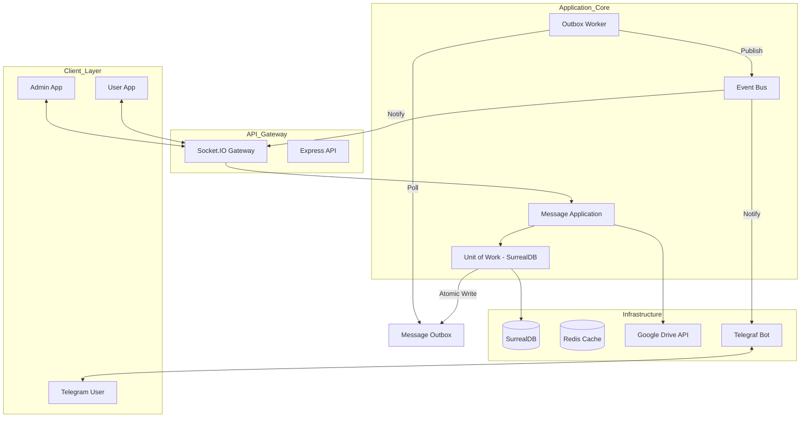

# Chat-Community

Hệ thống chat cộng đồng thời gian thực được xây dựng trên nền tảng **Clean Architecture** và **Event-Driven Design**. Dự án tập trung vào tính tin cậy của dữ liệu (Outbox Pattern) và khả năng tích hợp đa kênh (Websocket, Telegram).

## 🏗️ System Architecture



## 🚀 Tech Stack

- **Runtime**: Node.js + TypeScript
- **Database**: SurrealDB (Multi-model database)
- **Real-time**: Socket.IO
- **Caching**: Redis
- **File Storage**: Google Drive API
- **Framework**: Express.js
- **Bot Engine**: Telegraf (Telegram Bot API)

## ✨ Key Features & Patterns

- **Clean Architecture**: Phân tách rõ ràng giữa Domain, Application và Infrastructure.
- **Transactional Outbox Pattern**: Đảm bảo tin nhắn luôn được gửi đi ngay cả khi hệ thống Socket/Telegram gặp sự cố tạm thời.
- **Unit of Work**: Quản lý transaction nguyên tử trên SurrealDB.
- **Session Management**: Cơ chế "Graceful Disconnect" (F5/Reconnect) tránh spam thông báo online/offline.
- **File Processing**: Upload và quản lý file thông qua Google Drive Service Account.
- **Telegram Integration**: 
    - Tự động notify cho Admin khi có tin nhắn mới mà admin đang offline.
    - Bot hỗ trợ tạo Poll (Badminton, Boardgame) trực tiếp.

## ⚠️ Giới hạn triển khai: chỉ chạy MỘT instance

Redis adapter của Socket.IO giúp phát event qua nhiều process, nhưng các trạng thái sau
vẫn nằm trong RAM của từng process:

- Danh sách user online và bộ đếm kết nối (`SocketRoomJoinRegistry`)
- Timer grace period khi user mất kết nối (`SessionManager`)
- EventBus nội bộ (`InMemoryEventBus`)

Chạy từ 2 instance trở lên thì danh sách online, thông báo online/offline và việc dọn
phiên sẽ sai. Hãy chạy **một instance** (PM2 `instances: 1`, không dùng cluster mode).
Outbox worker đã an toàn khi chạy nhiều instance (claim nguyên tử), nhưng phần trên thì chưa.

## 🔐 Hợp đồng API (tóm tắt)

- Mọi route `/api/message/*` và `POST /api/auth/:userId/end` yêu cầu header
  `Authorization: Bearer <accessToken>`.
- `sender` luôn lấy từ token; `readerId` ở `mark-read`/`unread-count` cũng lấy từ token.
  User chỉ gửi được cho `admin` và chỉ đọc hội thoại của chính mình; admin đọc được tất cả.
- `POST /api/message/insert` (multipart): `receiver`, `content`, file ở field `file` hoặc
  `files` (tối đa `UPLOAD_MAX_FILES_PER_MESSAGE`). Nhiều file = **một** tin có `attachments[]`.
  Client không còn gửi được `imageURL`/`fileURL` tự đặt (tránh lách kiểm duyệt ảnh).
- Socket `message:send`: `{ receiver, content?, files?: [{ data, name, mimeType }] }`.
  Lưu thất bại sau khi đã ack → server gửi `message:error { tempId, reason }`.
- Access token và refresh token mang claim `type`; refresh token không dùng để kết nối socket
  được. Token phát hành trước bản cập nhật này không còn hợp lệ → client đăng nhập lại.
- Đăng nhập admin bị giới hạn `ADMIN_LOGIN_MAX_ATTEMPTS` lần sai / `ADMIN_LOGIN_WINDOW_SECONDS`
  theo IP. Chạy sau nginx thì phải đặt `TRUST_PROXY`, nếu không mọi client chung một IP.

## 🛠️ Installation

1. Copy `.env.example` thành `.env.development`.
2. Cấu hình SurrealDB và Redis.
3. Cấu hình Telegram Bot Token & Google Service Account (nếu dùng upload).
4. Chạy lệnh:
```bash
npm install
npm run dev
```

Kiểm tra trước khi đẩy code (CI cũng chạy đúng các lệnh này):

```bash
npm run type-check && npm run lint && npm test
```